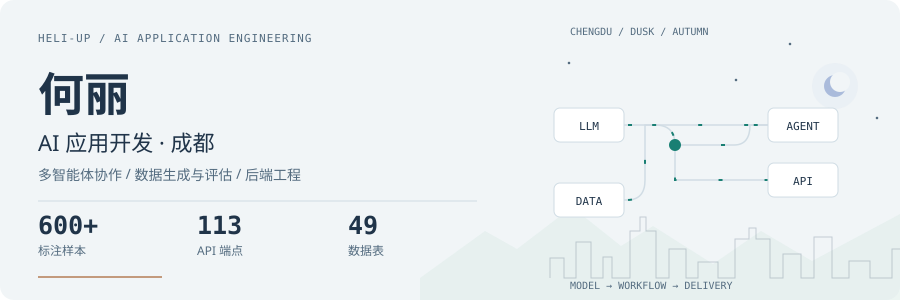
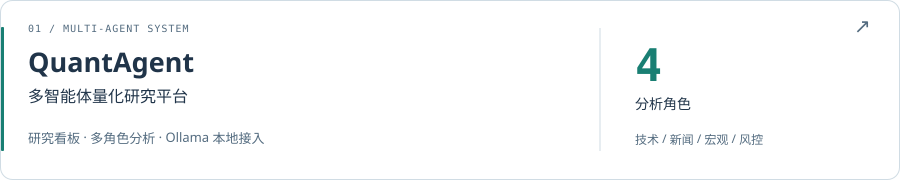
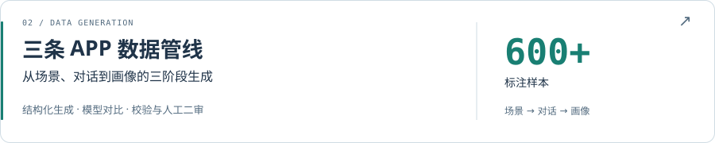
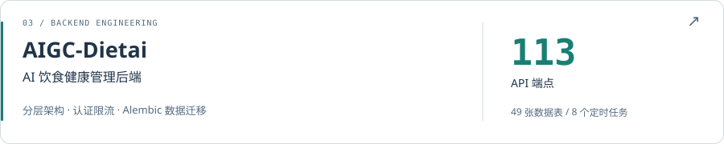
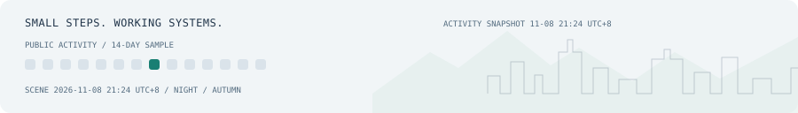

<picture>
  <source media="(max-width: 600px) and (prefers-color-scheme: dark)" srcset="assets/header-mobile-dark.svg">
  <source media="(max-width: 600px)" srcset="assets/header-mobile.svg">
  <source media="(prefers-color-scheme: dark)" srcset="assets/header-dark.svg">
  
</picture>

# 你好，我是何丽

**面向成都 AI 应用开发岗位，把大模型能力接入可验证、可交付的业务流程。**

西华大学 · 计算机科学与技术本科在读（2024–2028） · GPA 3.84/5.0  
做过多智能体量化平台、三阶段数据生成管线与 AI 健康管理后端，关注模型接入、数据质量和接口交付。

[邮件联系](mailto:1259109559@qq.com) · [项目案例](#项目案例) · [工程笔记](#工程笔记与公开动态)

## 技术与实践

**AI 应用** · 多角色协作、结构化生成与校验  
<code>DeepSeek</code> <code>Qwen</code> <code>OpenAI API</code> <code>Ollama</code>

**工程开发** · 接口、数据建模、认证与限流  
<code>Python</code> <code>FastAPI</code> <code>SQL</code> <code>Alembic</code>

**界面与协作** · 研究看板、接口联调与组件复用  
<code>Next.js</code> <code>shadcn/ui</code> <code>Git</code> <code>Swagger</code>

## 项目案例

<a href="docs/quantagent.md">
  <picture>
    <source media="(max-width: 600px) and (prefers-color-scheme: dark)" srcset="assets/quantagent-mobile-dark.svg">
    <source media="(max-width: 600px)" srcset="assets/quantagent-mobile.svg">
    <source media="(prefers-color-scheme: dark)" srcset="assets/quantagent-dark.svg">
    
  </picture>
</a>

**开发成员** · 重构总览看板与研究台，参与多角色分析、多空辩论及本地模型链路。  
[查看个人工作与实验](docs/quantagent.md) · [代码仓库（fork）](https://github.com/helililili/QuantAgent)

<a href="docs/data-pipeline.md">
  <picture>
    <source media="(max-width: 600px) and (prefers-color-scheme: dark)" srcset="assets/pipeline-mobile-dark.svg">
    <source media="(max-width: 600px)" srcset="assets/pipeline-mobile.svg">
    <source media="(prefers-color-scheme: dark)" srcset="assets/pipeline-dark.svg">
    
  </picture>
</a>

**数据集组成员** · 搭建三阶段生成管线，设计标签体系，完成多模型对比与人工二审。  
[查看流程与评估方法](docs/data-pipeline.md) · 企业项目以文字案例展示

<a href="docs/dietai.md">
  <picture>
    <source media="(max-width: 600px) and (prefers-color-scheme: dark)" srcset="assets/dietai-mobile-dark.svg">
    <source media="(max-width: 600px)" srcset="assets/dietai-mobile.svg">
    <source media="(prefers-color-scheme: dark)" srcset="assets/dietai-dark.svg">
    
  </picture>
</a>

**后端核心开发** · 负责分层架构、认证与业务接口，联调 AI 对话、饮食记录和宠物健康模块。  
[查看架构与交付范围](docs/dietai.md) · [代码仓库（fork）](https://github.com/helililili/DietAI)

项目规模与个人职责按项目经历整理；公开代码入口保留 fork 标识，具体实现与实验口径见各案例。

## 工程笔记与公开动态

- [多智能体研究台：让行情、分析与证据链在同一界面协作](docs/quantagent.md)
- [从单阶段 Prompt 到三阶段数据生成与校验](docs/data-pipeline.md)
- [AI 应用后端：从数据模型到接口交付](docs/dietai.md)

<!-- ACTIVITY:START -->
[查看 GitHub 公开开发动态](https://github.com/helililili?tab=overview#activity)
<!-- ACTIVITY:END -->

## 联系

关注 **成都 AI 应用开发工程师** 机会，欢迎交流项目实现与岗位需求。  
邮箱：**[1259109559@qq.com](mailto:1259109559@qq.com)**

<picture>
  <source media="(prefers-color-scheme: dark)" srcset="assets/footer-dark.svg">
  
</picture>

场景随北京时间、季节与公开活动采样更新 · 原生 SVG / Python 标准库 · [设计与更新机制](docs/design.md)
